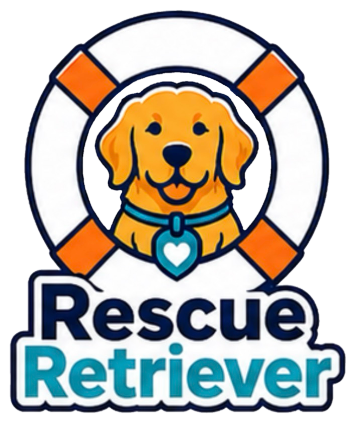

<!--
File: README.md
Document Title: Rescue Retriever
Author: Alysha Pursley
Last Updated: November 2026
-->

<div align="center">



<h1>Rescue Retriever 🦮</h1>

<p><a href="https://github.com/apursley2012/rescue-retriever/stargazers"></a> <a href="https://github.com/apursley2012/rescue-retriever/forks"></a> <a href="https://github.com/apursley2012/rescue-retriever/issues"></a> <a href="https://github.com/apursley2012/rescue-retriever/commits"></a> <a href="https://github.com/apursley2012/rescue-retriever"></a> <a href="https://github.com/apursley2012/rescue-retriever"></a></p>

<p><a href="https://apursley2012.github.io/rescue-retriever/"></a>    </p>

<p><strong>A rescue-candidate screening dashboard that turns a historical Austin Animal Center dataset into explainable program matches, individual dog profiles, analytics, a selected-record map, and downloadable CSV reports.</strong></p>

<p><a href="https://apursley2012.github.io/rescue-retriever/">Open the live project</a> · <a href="https://github.com/apursley2012/rescue-retriever">View the repository</a> · <a href="https://github.com/apursley2012/rescue-retriever/issues/new">Report an issue or suggest an improvement</a></p>

</div>

---

## Table of Contents 📖

- [Project Overview 🔎](#project-overview)
  - [Purpose 🎯](#purpose)
  - [Design Style and Inspiration 🎨](#design-style-and-inspiration)
  - [Main Color Palette 🌈](#main-color-palette)
  - [Preview Screenshots 🖼️](#preview-screenshots)
- [Key Features ✨](#key-features)
- [Tech Stack 🛠️](#tech-stack)
- [Live Demo 🚀](#live-demo)
- [Installation 📦](#installation)
  - [Local Use 💻](#local-use)
  - [GitHub Pages Deployment 🌐](#github-pages-deployment)
- [Usage 🧭](#usage)
- [Project Structure 🗂️](#project-structure)
  - [Pages Included 📄](#pages-included)
  - [Core Files and Architecture 🧩](#core-files-and-architecture)
  - [File and Folder Structure 🌳](#file-and-folder-structure)
- [Data, Matching, and Rescue Programs 🐾](#data-matching-and-rescue-programs)
- [Customization Guide 🎨](#customization-guide)
- [Accessibility and Browser Compatibility ♿](#accessibility-and-browser-compatibility)
- [Repository Relationship 🔗](#repository-relationship)
- [Project Scope and Limitations 📌](#project-scope-and-limitations)
- [Possible Future Enhancements 💡](#possible-future-enhancements)
- [Contributing 🤝](#contributing)
  - [Reporting Issues 🐛](#reporting-issues)
  - [Requesting Additions 📝](#requesting-additions)
- [License 📜](#license)
- [Important Links 🔗](#important-links)
- [Attribution ℹ️](#attribution)

---

<a id="project-overview"></a>
<details open>
<summary><h2>Project Overview 🔎</h2></summary>

I developed **Rescue Retriever** to explore how animal shelter records can support preliminary screening for search-and-rescue training. The repository preserves my original Python/MongoDB dashboard coursework alongside a separate, interactive browser demonstration. The public website can run on GitHub Pages without a Python server or a MongoDB connection.

The updated demonstration brings together dog-only screening, candidate profiles, rescue-program criteria, search, sorting, pagination, local shortlists, data visualizations, CSV exports, and a map for one selected animal record. I also included a six-section case study, four researched articles on their own pages, technical documentation, legal notices, and a branded 404 page.

**Rescue Retriever identifies records worth reviewing, not dogs proven suitable for rescue work.** Its matches are determined by the project's explicit breed, recorded-sex, and age rules. Qualified trainers and current shelter information are still needed for any real-world evaluation.

</details>

<a id="purpose"></a>
<details open>
<summary><h3>Purpose 🎯</h3></summary>

I wanted to make a large shelter dataset easier to navigate when looking for dogs that meet specific search-and-rescue screening criteria. Instead of manually searching records and repeating the same comparisons, I organized the information into three rescue profiles, an interactive results table, individual dog views, and exportable reports. The interface shows the information behind each candidate's qualification so the screening process is understandable and reproducible.

</details>

<a id="design-style-and-inspiration"></a>
<details open>
<summary><h3>Design Style and Inspiration 🎨</h3></summary>

I used dark navy for the primary structure and high-contrast headers, orange for prominent actions and rescue-themed emphasis, and teal for supporting data and interaction accents. White cards and pale gray-blue backgrounds give the tables, charts, and detailed content room to breathe. The three rescue programs also have distinct accent colors so I can separate their statistics and controls without relying on color alone.

The updated site uses a shared navigation and footer, page-specific layouts, and styles for smaller screens. The original notebook is preserved separately rather than being presented as the source of the later web design.

</details>

<a id="main-color-palette"></a>
<details open>
<summary><h3>Main Color Palette 🌈</h3></summary>

I checked these colors against the distributed stylesheet rules in `Current-Updated/web-demo/assets/main.css`, the shared styles in `styles/shared.css`, and page-level styling. The table describes specific uses in the current interface, rather than assigning arbitrary labels to the hex values.

| Hex | Color Name | Where I Use It |
| --- | --- | --- |
| `#F47920` | Rescue Orange | Main call-to-action buttons, the dashboard's export action, article accents, active highlights, and orange portions of gradients. |
| `#1A2F5E` | Rescue Navy | Main headings and text emphasis, dark section headers, statistic and navigation treatments, and branded page backgrounds. |
| `#0D1B38` | Deep Navy | Darkest hero-background gradients, deep navigation surfaces, and contrast-heavy branded areas. |
| `#2BBCD4` | Rescue Teal | Data/analytics accents, selected visual details, gradient highlights, and supporting interactive emphasis. |
| `#F6F8FB` | Light Background | Main light application background, table-header backgrounds, and contrasting surfaces around white content cards. |
| `#EEF2F8` | Muted Surface | Secondary panels, card dividers, subtle separators, and subdued backgrounds in the data interface. |
| `#F8A058` | Light Orange | Softer orange highlights and gradient transitions paired with the primary orange. |
| `#253D7A` | Medium Navy | Midpoint of the Case Study hero gradient and supporting darker hover/background treatments. |
| `#60D4E8` | Light Teal | Brighter teal ends of gradients and lighter decorative highlights. |
| `#D8E0EE` | Border Gray-Blue | Outlines on cards, the results table, search controls, and other structural borders. |
| `#4A5B7A` | Muted Text | Explanatory text, secondary labels, field descriptions, and supporting content on light backgrounds. |

The rescue profiles additionally use `#DF5A1A` for Water Rescue, `#087F8C` for Mountain/Wilderness Rescue, and `#6D3DB8` for Disaster/Tracking identification and program-specific controls.

</details>

<a id="preview-screenshots"></a>
<details open>
<summary><h3>Preview Screenshots 🖼️</h3></summary>

I have not included a screenshot gallery in this repository version, so there are no placeholder images or unverified `images/screenshots/` paths here. The [live demonstration](https://apursley2012.github.io/rescue-retriever/) provides the current visual preview of the Home, Dashboard, Analytics, Rescue Profiles, Reports, Case Study, Articles, and Documentation areas.

</details>

---

<a id="key-features"></a>
<details open>
<summary><h2>Key Features ✨</h2></summary>

- **Three strict rescue-profile filters:** Screen dog records for Water Rescue, Mountain/Wilderness Rescue, and Disaster/Tracking using documented breed, sex, and age conditions.
- **Dog search and results table:** Search by name, ID, breed, or color; sort supported columns; and move through paginated results.
- **Candidate details and scoring:** Open an animal's recorded information, review qualification results for the rescue profiles, and see the displayed match score.
- **One-record map:** Select **Show on map** from a table row to view that record's source coordinate, name, and breed, with zoom controls. The coordinates are historical source data, not live animal tracking.
- **Local shortlist:** Add or remove dogs from a browser-stored shortlist and export the shortlisted entries. This is not a shared team account or server database.
- **Analytics:** Compare dog-only counts and rescue qualifications; inspect breed, age, and sex summaries; filter the responsive breed/sex comparisons by program and search.
- **Reports and CSV downloads:** Export the full source dataset with classifications, individual rescue-program candidate lists, the current dashboard selection, or the local shortlist.
- **Rescue Profiles:** Read the exact screening criteria and the intended training context for each category.
- **Research and documentation:** Read the six-section Case Study, four individual researched articles with source links, and the application's expandable technical/user guide.
- **Supporting pages:** Responsive standalone article entries, Privacy Notice, Terms of Use, and a custom branded 404 page.

</details>

---

<a id="tech-stack"></a>
<details open>
<summary><h2>Tech Stack 🛠️</h2></summary>

The repository contains **two distinct implementations**. These are the technologies actually represented in the delivered files:

| Technology | How It Is Used in Rescue Retriever |
| --- | --- |
| HTML, JavaScript modules, and CSS | Provide direct-access site pages, browser entry points, shared and page-specific styling, and interactive application logic in `Current-Updated/web-demo/`. |
| React and React DOM | Render the interactive navigation, dashboard, candidate detail views, analytics, reports, articles, and shared interface components. |
| React Router | Connect the React views and candidate/article routes; the site also supplies direct HTML entry pages suitable for static hosting. |
| Tailwind-generated CSS and custom styles | Supply the existing utility classes and visual design in `assets/main.css`, with maintainable project-specific rules in `styles/`. |
| Recharts and chart helpers | Support the rendered analytics and category/breed visualizations in the browser demonstration. |
| Radix UI/shadcn-style components, Lucide, and Sonner | Supply accessible UI primitives, icon rendering, and notification-related components included in the recovered browser distribution. |
| Browser `localStorage` and `sessionStorage` | Keep shortlist IDs across local visits and retain dashboard filters, search, sorting, and page preferences within a browser session. |
| Python, Jupyter/Dash, PyMongo, pandas, Plotly, and Dash-Leaflet | Support the **original** notebook/dashboard, MongoDB CRUD module, data handling, charts, and map integration in `Original/`. |
| GitHub Actions and GitHub Pages | Validate the project and publish the nested static site without publishing or executing the original Python/MongoDB application. |

The distributed website includes recovered/compiled runtime files, not a complete editable TypeScript/Vite source-and-build setup. I therefore do **not** present this repository as a runnable TypeScript/Vite development project or require npm/Vite commands to view the static site. See [`THIRD_PARTY_NOTICES.md`](THIRD_PARTY_NOTICES.md) for dependency provenance and licenses.

</details>

---

<a id="live-demo"></a>
<details open>
<summary><h2>Live Demo 🚀</h2></summary>

My public demonstration is available at [https://apursley2012.github.io/rescue-retriever/](https://apursley2012.github.io/rescue-retriever/). The published version may lag behind files in a new ZIP until I commit those changes and the GitHub Actions deployment completes.

</details>

---

<a id="installation"></a>
<details open>
<summary><h2>Installation 📦</h2></summary>

The public demonstration is static and requires no database credentials, API key, npm installation, or production backend. The original Python project has different runtime requirements and is not executed by GitHub Pages.

</details>

<a id="local-use"></a>
<details open>
<summary><h3>Local Use 💻</h3></summary>

To run the current browser demonstration from the repository root, I use a local HTTP server:

```bash
git clone https://github.com/apursley2012/rescue-retriever.git
cd rescue-retriever/Current-Updated/web-demo
python3 -m http.server 8000
```

Then I open `http://localhost:8000/` in a browser. The direct HTML documents under `pages/` work from the same server. Serving the files over HTTP avoids the module-loading limitations of opening the HTML through a `file://` URL.

The original dashboard lives in `Original/`, with separate [`Original/README.md`](Original/README.md), [`Original/requirements.txt`](Original/requirements.txt), and [`.env.example`](Original/.env.example) files. It needs a compatible Python environment and a properly configured MongoDB connection for its database-backed features. The example configuration does not contain real credentials.

For repository-level regression checks, I can run:

```bash
node --experimental-default-type=module --test tests/*.test.mjs
python3 -m unittest discover -s tests -p 'test_*.py' -v
```

</details>

<a id="github-pages-deployment"></a>
<details open>
<summary><h3>GitHub Pages Deployment 🌐</h3></summary>

The deployable website is **not** stored at the repository root. I keep its entry page at `Current-Updated/web-demo/index.html` and deploy that directory using [`.github/workflows/deploy-pages.yml`](.github/workflows/deploy-pages.yml). This workflow is retained because it is needed for the existing nested-site deployment arrangement.

To use the included workflow, I open the repository's **Settings → Pages**, choose **GitHub Actions** as the build/deployment source, and commit the project to the default branch. The workflow checks JavaScript syntax, runs the included regression tests, validates paths/assets, publishes only `Current-Updated/web-demo/`, and checks selected published resources afterward. Its deployment stage runs on the default branch, not on pull requests.

The static website uses repository-subpath-safe relative resources and direct page entries. The deployment does not run Python, contact MongoDB on behalf of visitors, or publish the original notebook and database configuration as part of the website artifact.

</details>

---

<a id="usage"></a>
<details open>
<summary><h2>Usage 🧭</h2></summary>

1. **Start at Home** to read the project introduction and open the Dashboard or one of the three Rescue Profiles.
2. **Choose a profile** in the Dashboard, or select **All Animals** to browse all 5,589 dog records in the project extract. Search, sort the available columns, and use pagination to narrow the table.
3. **Review one dog** by choosing **View** for its candidate profile. The detail page exposes recorded attributes and rescue qualification information.
4. **Check the location data** by choosing **Show on map** on a dog row. The map focuses on the selected record rather than automatically plotting every filtered dog.
5. **Save or export a shortlist** by toggling the row's shortlist control. Shortlist IDs live in that browser's local storage; exports create a CSV on the user's device.
6. **Analyze or report** using Analytics for summary visualizations and Reports for the complete-dataset or program-specific CSV downloads.
7. **Explore the writing and technical material** through the Case Study, four individual Articles, Rescue Profiles, and Documentation pages.

No account or server-side data editing is available in this GitHub Pages version.

</details>

---

<a id="project-structure"></a>
<details open>
<summary><h2>Project Structure 🗂️</h2></summary>

The repository separates the original coursework from the later static portfolio application. The tables below use **actual paths and responsibilities**, including the files where I edit visible content, screening rules, styles, and publishing behavior.

</details>

<a id="pages-included"></a>
<details open>
<summary><h3>Pages Included 📄</h3></summary>

All paths in this table are relative to `Current-Updated/web-demo/`.

| Page / File | What This Page Actually Does |
| --- | --- |
| `index.html` | Loads the root React application, its site-wide styles, metadata, and hash-route entry point. |
| `pages/home.html` | Introduces the rescue-candidate screening idea, highlights dataset statistics and program categories, and directs visitors into the workflow. |
| `pages/dashboard.html` | Opens the interactive dog-results dashboard with profile filters, search, sortable/paginated rows, shortlist controls, CSV export, and a map for one selected record. |
| `pages/candidate-detail.html` | Loads the selected dog via its `id` query parameter and presents recorded details and rescue-profile qualification information. |
| `pages/analytics.html` | Displays dog-only counts, rescue-program totals, breed distributions, age groups, and sex breakdowns; program/search controls update selected comparisons. |
| `pages/rescue-profiles.html` | Explains Water Rescue, Mountain/Wilderness Rescue, and Disaster/Tracking criteria, including breed lists, required recorded sex, age ranges, and profile context. |
| `pages/reports.html` | Presents downloadable CSV reports for the complete animal dataset and each of the three rescue-program candidate groups. |
| `pages/case-study.html` | Presents my six project sections: Background, Research, Development Process, Challenges, Results, and Future Improvements. |
| `pages/articles.html` | Displays article summaries and links to the four separate research/technical writing pages. |
| `pages/shelter-to-service.html` | Publishes my researched article about turning shelter records into a responsible initial rescue-candidate screening workflow. |
| `pages/breed-data-limitations.html` | Discusses uncertainty in shelter breed labels, strict breed matching, data quality, and the limits of visual identification. |
| `pages/geographic-patterns.html` | Examines what geographic and shelter-location information can and cannot establish about rescue screening. |
| `pages/development-process.html` | Explains the application's implementation choices, reusable criteria, interface structure, and data-driven development process. |
| `pages/article-detail.html` | Retains the shared article-detail entry for older query-parameter links; individual published articles have their own HTML files above. |
| `pages/documentation.html` | Provides the expandable technical reference, data dictionary, rescue criteria, usage guide, and links to major tools. |
| `pages/privacy.html` | Explains local browser storage, historical data use, external font/map resource requests, and hosting-related privacy considerations. |
| `pages/terms.html` | States the educational-demo scope, restrictions/limitations, and relationship to the repository's proprietary and third-party licensing terms. |
| `404.html` | Displays a branded not-found page with accessible links back to Home, Dashboard, Privacy, and Terms. |

The site also contains corresponding `pages/*.js` view modules for interactive routes, plus `runtime/page-entry.js` to connect direct HTML documents to the correct React view.

</details>

<a id="core-files-and-architecture"></a>
<details open>
<summary><h3>Core Files and Architecture 🧩</h3></summary>

The table identifies **where a feature is implemented or maintained**, rather than describing every JavaScript file as a generic project script. Paths beginning with `Current-Updated/web-demo/` are shortened to `web-demo/` here for readability.

| File / Folder | Actual Role in the Project |
| --- | --- |
| `web-demo/data/animals.js` | Bundles the historical shelter records into the browser demo so the site can filter and analyze them without calling MongoDB. |
| `web-demo/data/rescueProfiles.js` | Defines the three program identities, strict breed lists, recorded-sex requirements, age bounds, descriptions, and display colors used throughout the site. |
| `web-demo/lib/filterUtils.js` | Applies the consistent search and screening rules and supplies shared filtering, sorting, scoring, candidate counting, shortlist, and CSV-export helpers. |
| `web-demo/data/caseStudy.js` | Holds the editable first-person text for the six Case Study sections that the interactive page renders. |
| `web-demo/data/articles.js` | Holds the four articles' titles, categories, dates, summaries, and structured text for the React article index/detail routes. The standalone article HTML documents also carry their own readable page content. |
| `web-demo/pages/dashboard.js` | Owns dashboard state: filters, query text, column order, current page, browser-stored shortlist, export actions, and selected map record. |
| `web-demo/components/dashboard/DogResultsTable.js` | Renders the results table, sortable column headings, dog rows, pagination controls, View links, map-selection buttons, and shortlist toggles. |
| `web-demo/components/visualizations/RescueCandidateCoordinates.js` | Builds the map tiles, selected-record pin/label, zoom controls, and unavailable-coordinate handling for the selected dog. |
| `web-demo/components/visualizations/DogAnalyticsCharts.js` and `CategoryBreakdown.js` | Render the data-summary charts and categorical comparisons used by analytics views. |
| `web-demo/pages/analytics.js` and `analyticsMetrics.js` | Assemble the Analytics view and calculate age/sex/breed-group summaries used in its comparisons. |
| `web-demo/pages/reports.js` | Creates the complete-dataset and program-specific export actions, filenames, record counts, and download feedback. |
| `web-demo/components/layout/Navigation.js` and `Footer.js` | Supply shared branded site navigation and footer links so routes use the same site-level controls. |
| `web-demo/lib/pageLinks.js` | Builds links to actual HTML pages and article/candidate detail entries without assuming the site is hosted at a domain root. |
| `web-demo/runtime/router.js` and `page-entry.js` | Connect hash routes and direct HTML entry URLs to React pages; set route-specific metadata and map query parameters to views. |
| `web-demo/assets/runtime-core.js` and related `assets/*.js` | Supply the recovered browser-ready React/library runtime and compatibility exports. These are not an independently reconstructed, editable TypeScript source project. |
| `web-demo/assets/main.css` | Contains the distributed/generated base and utility styling used by the site, including font requests and much of the existing visual framework. |
| `web-demo/styles/shared.css` and `styles/pages/*.css` | Contain project-level design tokens, shared fallback/accessibility styles, and targeted page layouts, including dashboard, articles, legal pages, and the 404 page. |
| `web-demo/assets/logo.png`, icons, and `manifest.webmanifest` | Provide the website's branding, browser/favicon assets, and installable-app metadata. |
| `Original/animal_shelter.py` | Implements the original MongoDB create/read/update/delete (CRUD) interface; not run by the static website. |
| `Original/ProjectTwoDashboard.ipynb` | Preserves the original Dash/Jupyter dashboard and related notebook work. |
| `Original/aac_shelter_outcomes.csv` | Preserves the supplied historical source data alongside the Python coursework. |
| `Original/requirements.txt` and `.env.example` | Document the original Python dependencies and required MongoDB configuration names without exposing real secrets. |
| `.github/workflows/deploy-pages.yml` | Runs source/static-site verification and the tests, publishes only the browser demo, and checks selected live GitHub Pages resources. |
| `tests/` | Holds JavaScript and Python regression checks for screening, maps, CSV/data contracts, original CRUD behavior, and static resource integrity. |
| `LICENSE` and `THIRD_PARTY_NOTICES.md` | Separate the terms for my original project contributions from third-party copyright/license notices, fonts, libraries, data, and inherited materials. |

</details>

<a id="file-and-folder-structure"></a>
<details open>
<summary><h3>File and Folder Structure 🌳</h3></summary>

This is the repository's actual top-level organization and the major application areas. Detailed filenames and their functions are listed in the two tables above.

```text
rescue-retriever/
├── .github/
│   └── workflows/
│       └── deploy-pages.yml
├── Current-Updated/
│   └── web-demo/
│       ├── index.html
│       ├── 404.html
│       ├── .nojekyll
│       ├── assets/
│       ├── components/
│       │   ├── dashboard/
│       │   ├── layout/
│       │   ├── ui/
│       │   └── visualizations/
│       ├── data/
│       ├── hooks/
│       ├── lib/
│       ├── pages/
│       ├── runtime/
│       ├── styles/
│       │   └── pages/
│       ├── manifest.webmanifest
│       └── robots.txt
├── Original/
│   ├── ProjectTwoDashboard.ipynb
│   ├── animal_shelter.py
│   ├── aac_shelter_outcomes.csv
│   ├── requirements.txt
│   ├── .env.example
│   └── README.md
├── tests/
├── LICENSE
├── THIRD_PARTY_NOTICES.md
└── README.md
```

The original folder also preserves a historical image asset. That asset is not part of the updated website's branding or its deployed GitHub Pages files.

</details>

---

<a id="data-matching-and-rescue-programs"></a>
<details open>
<summary><h2>Data, Matching, and Rescue Programs 🐾</h2></summary>

I use a **fixed historical extract** of Austin Animal Center outcomes. The supplied extract contains **10,000 animal records**, of which **5,589 are dog records**. Rescue screening operates on dogs and uses recorded breed, sex, and age, not behavioral testing or live shelter inventory.

| Rescue Profile | Exact Recorded Criteria | Matches in This Extract |
| --- | --- | ---: |
| **Water Rescue** | Labrador Retriever Mix, Chesapeake Bay Retriever, or Newfoundland; **Intact Female**; **26–156 weeks**. | **17** |
| **Mountain / Wilderness Rescue** | German Shepherd, Alaskan Malamute, Old English Sheepdog, Siberian Husky, or Rottweiler; **Intact Male**; **26–156 weeks**. | **5** |
| **Disaster Rescue / Individual Tracking** | Doberman Pinscher, German Shepherd, Golden Retriever, Bloodhound, or Rottweiler; **Intact Male**; **20–300 weeks**. | **4** |

There are **24 unique matching dogs** but **26 program matches**, because two dogs meet criteria for more than one profile. The breed comparison trims outer whitespace but does not automatically equate `Mix` with `Mixed`, add synonyms, or infer genetic ancestry. The Dashboard can show a match score, but that score is an application screening aid, **not** a measure of actual rescue-training readiness.

The map shows **one selected animal's recorded coordinate at a time**. I retain source latitude and longitude in CSV exports where available, but I do not represent these coordinates as current positions or independently verified shelter locations. Analytics gives dog-only aggregate comparisons, while the Reports page also supports an export of the **entire 10,000-record source extract** with rescue classifications.

</details>

---

<a id="customization-guide"></a>
<details open>
<summary><h2>Customization Guide 🎨</h2></summary>

I keep changes in the files responsible for each feature. For updated rescue criteria, I edit `data/rescueProfiles.js` and verify `lib/filterUtils.js` and the expected candidate counts together. For dashboard filtering, sorting, shortlist state, exports, or map selection, I start with `pages/dashboard.js`, `DogResultsTable.js`, and `RescueCandidateCoordinates.js`. For the six Case Study sections, I edit `data/caseStudy.js` rather than burying narrative changes in the compiled runtime.

For article metadata and the React article-detail route, I use `data/articles.js`. Because the four standalone article HTML files include their own full text, I also keep the relevant `pages/<article-id>.html` file synchronized when revising an article. For shared navigation or links, I use the layout components and `lib/pageLinks.js`. For visual updates, I use the existing shared design system and the relevant `styles/pages/` stylesheet, checking that generated `assets/main.css` rules still interact correctly with them.

I avoid editing recovered vendor/runtime internals unless a verified compatibility fix requires it, and I rerun the applicable tests whenever I change matching rules, page links, or data contracts.

</details>

---

<a id="accessibility-and-browser-compatibility"></a>
<details open>
<summary><h2>Accessibility and Browser Compatibility ♿</h2></summary>

The site includes semantic page sections, skip-to-content links, labels or accessible names for important controls, sortable table headings with direction announcements, keyboard-reachable navigation, focus treatments, and responsive rules. The standalone 404 and legal pages provide simple HTML navigation as well. The wide results table uses an independently scrollable region on narrow screens instead of forcing every field into an unreadable column.

I review responsive behavior at mobile, tablet, and desktop widths and preserve reduced-motion handling where implemented. Some static layouts and the dashboard hero have been checked at multiple widths, but that does not establish complete compatibility with every browser, screen reader, zoom setting, or interactive state. I do not claim a formal WCAG certification or a comprehensive Safari/Chrome/Firefox/Edge test matrix.

</details>

<a id="repository-relationship"></a>
<details open>
<summary><h2>Repository Relationship 🔗</h2></summary>

I keep **both versions of Rescue Retriever** because they demonstrate different parts of the project. `Original/` preserves the Python CRUD and notebook-based dashboard work; `Current-Updated/web-demo/` is the later browser-ready portfolio implementation. The website is not a live Python/MongoDB instance and does not replace the original implementation's technical history.

The application, case study, articles, legal pages, data, and documentation all belong to this repository. GitHub Pages publishes only the nested browser demo; the original notebook and Python files remain available as repository source for review.

</details>

---

<a id="project-scope-and-limitations"></a>
<details open>
<summary><h2>Project Scope and Limitations 📌</h2></summary>

- The browser demo uses bundled historical records; it does not query the current Austin Animal Center system or report real-time availability.
- Candidate matches and scores are preliminary rule-based screening outputs, not veterinary, behavioral, or professional search-and-rescue evaluations.
- The public website does not provide logins, shared persistent shortlists, editable shelter records, server-side MongoDB CRUD, or a live backend API.
- Dashboard preferences are stored in session storage, and selected shortlist IDs are stored locally in the browser when storage is available. Clearing browser data can remove them.
- Map tiles and fonts may require external requests to OpenStreetMap and Google Fonts. External providers can have their own availability and privacy practices.
- The browser distribution contains compiled/recovered third-party runtime files and does not include a full original TypeScript/Vite build project or a lockfile for exact dependency reproduction.
- Some inherited educational materials and recovered dependencies have provenance limitations described in the third-party notices. A public portfolio does not remove those third-party rights.

</details>

---

<a id="possible-future-enhancements"></a>
<details open>
<summary><h2>Possible Future Enhancements 💡</h2></summary>

- Connect the demonstration to a properly hosted, permissioned live data source, while clearly separating current shelter status from historical records.
- Add shared, account-backed candidate review for authorized teams instead of relying only on the existing local shortlist.
- Introduce reviewed breed-label normalization and data-quality indicators without silently changing strict qualification results.
- Expand field-assessment notes, comparison tools, and follow-up workflow for qualified trainers.
- Explore map views for **verified** multi-record geographic information, rather than treating source coordinates as live positions.

</details>

---

<a id="contributing"></a>
<details open>
<summary><h2>Contributing 🤝</h2></summary>

I welcome bug reports, accessibility feedback, documentation corrections, and project-specific suggestions through GitHub Issues. **This is a proprietary project, not an open-source contribution grant.** Please contact me before submitting or reusing modified project-owned code; the permissions for my work are specified in [`LICENSE`](LICENSE), and third-party materials retain their own terms.

</details>

<a id="reporting-issues"></a>
<details open>
<summary><h3>Reporting Issues 🐛</h3></summary>

When reporting an issue, please include the page URL, steps to reproduce, what you expected, what happened, the browser/device involved, and a screenshot if the problem is visual. I especially appreciate reports of incorrect candidate counts, broken article links, clipped mobile content, or unexpected CSV output.

</details>

<a id="requesting-additions"></a>
<details open>
<summary><h3>Requesting Additions 📝</h3></summary>

Feature requests should explain which Rescue Retriever workflow the improvement supports, what information or interaction is missing, and how it would help with accurate candidate review. I prioritize changes that preserve transparent screening rules and keep the static demo's limitations clear.

</details>

---

<a id="license"></a>
<details open>
<summary><h2>License 📜</h2></summary>

**Copyright © 2026 Alysha Pursley. All rights reserved in my original contributions.** My project-owned code, writing, branding, and other solely owned materials are covered by the repository's [proprietary LICENSE](LICENSE). A public GitHub repository does not automatically make those contributions open source.

Third-party libraries, fonts, the source dataset, inherited educational materials, and other separately owned works are **not** relicensed under my proprietary terms. Their notices and applicable license texts are in [`THIRD_PARTY_NOTICES.md`](THIRD_PARTY_NOTICES.md). The text of the repository's `LICENSE` is controlling; this README is a summary, not a replacement.

</details>

---

<a id="important-links"></a>
<details open>
<summary><h2>Important Links 🔗</h2></summary>

- **Live project:** [https://apursley2012.github.io/rescue-retriever/](https://apursley2012.github.io/rescue-retriever/)
- **Repository:** [https://github.com/apursley2012/rescue-retriever](https://github.com/apursley2012/rescue-retriever)
- **Issues and suggestions:** [https://github.com/apursley2012/rescue-retriever/issues/new](https://github.com/apursley2012/rescue-retriever/issues/new)
- **Original project documentation:** [`Original/README.md`](Original/README.md)
- **Copyright and reuse terms:** [`LICENSE`](LICENSE)
- **Third-party licenses and attribution:** [`THIRD_PARTY_NOTICES.md`](THIRD_PARTY_NOTICES.md)

</details>

---

<a id="attribution"></a>
<details open>
<summary><h2>Attribution ℹ️</h2></summary>

The demonstration uses a historical **Austin Animal Center outcomes** data extract. Its browser distribution also includes third-party React-related software, charting and interface libraries, Lucide icons, Google Fonts (Syne, Inter, and JetBrains Mono), and OpenStreetMap tile requests. The original Python notebook has its own separately installed dependencies and preserves historical educational materials. I identify their ownership, providers, upstream sources, and applicable terms in [`THIRD_PARTY_NOTICES.md`](THIRD_PARTY_NOTICES.md) rather than claiming them as my own.

</details>

---

<div align="center">

***Made with ❤️ and a bit of 🪄.***

**© 2026 Alysha Pursley. All Rights Reserved.**

</div>
