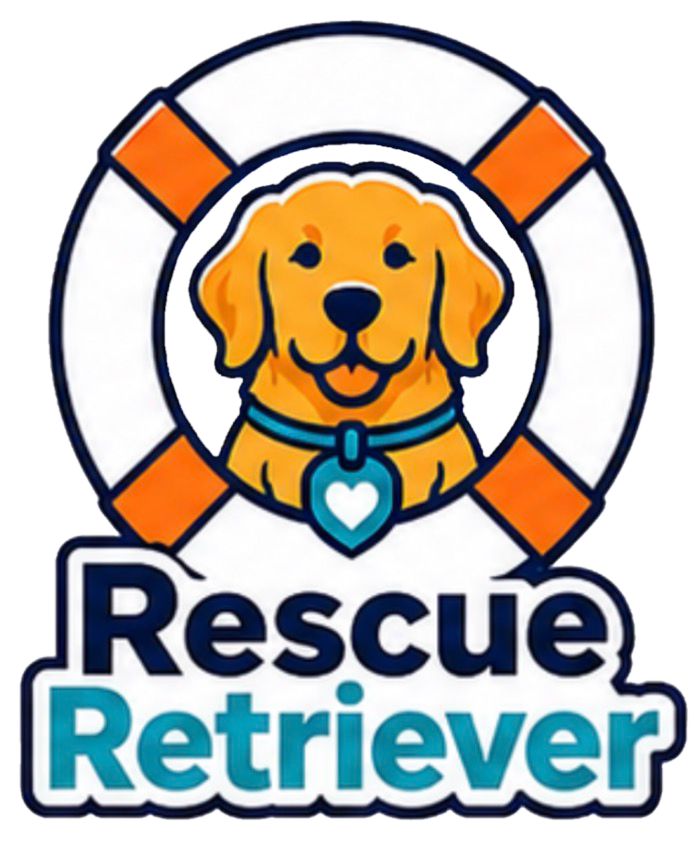

<!--
File: README.md
Document Title: Rescue Retriever
Author: Alysha Pursley
Date: August 2026
-->

<div align="center">



<h1>Rescue Retriever 🦮</h1>

<p><a href="https://github.com/apursley2012/rescue-retriever/stargazers"></a> <a href="https://github.com/apursley2012/rescue-retriever/forks"></a> <a href="https://github.com/apursley2012/rescue-retriever/issues"></a> <a href="https://github.com/apursley2012/rescue-retriever/commits"></a> <a href="https://github.com/apursley2012/rescue-retriever"></a> <a href="https://github.com/apursley2012/rescue-retriever"></a></p>

<p><a href="https://apursley2012.github.io/rescue-retriever/"></a>     </p>

<p><strong>A search-and-rescue candidate dashboard that turns Austin Animal Center shelter data into filterable rescue-program matches, animal details, analytics, maps, and exportable reports.</strong></p>

<p><a href="https://apursley2012.github.io/rescue-retriever/">Open the live project</a> · <a href="https://github.com/apursley2012/rescue-retriever">View the repository</a> · <a href="https://github.com/apursley2012/rescue-retriever/issues/new/choose">Report an issue or request an addition</a></p>

</div>

---

## Table of Contents 📖

*   [Project Overview 🔎](#project-overview)
    *   [Purpose 🎯](#purpose)
    *   [Design Style and Inspiration 🎨](#design-style-and-inspiration)
    *   [Main Color Palette 🌈](#main-color-palette)
    *   [Preview Screenshots 🖼️](#preview-screenshots)
*   [Key Features ✨](#key-features)
*   [Tech Stack 🛠️](#tech-stack)
*   [Live Demo 🚀](#live-demo)
*   [Installation 📦](#installation)
    *   [Local Use 💻](#local-use)
    *   [GitHub Pages Deployment 🌐](#github-pages-deployment)
*   [Usage 🧭](#usage)
*   [Project Structure 🗂️](#project-structure)
    *   [Pages Included 📄](#pages-included)
    *   [Core Files and Architecture 🧩](#core-files-and-architecture)
    *   [File and Folder Structure 🌳](#file-and-folder-structure)
*   [Data, Matching, and Rescue Programs 🐾](#data-matching-and-rescue-programs)
*   [Customization Guide 🎨](#customization-guide)
*   [Accessibility and Browser Compatibility ♿](#accessibility-and-browser-compatibility)
*   [Repository Relationship 🔗](#repository-relationship)
*   [Project Scope and Limitations 📌](#project-scope-and-limitations)
*   [Possible Future Enhancements 💡](#possible-future-enhancements)
*   [Contributing 🤝](#contributing)
    *   [Reporting Issues 🐛](#reporting-issues)
    *   [Requesting Additions 📝](#requesting-additions)
*   [License 📜](#license)
*   [Important Links 🔗](#important-links)
*   [Copyright ©️](#copyright)

---

<a id="project-overview"></a>

<details open>
<summary><h2><strong>Project Overview 🔎</strong></h2></summary>


**Rescue Retriever** a search-and-rescue candidate dashboard that turns Austin Animal Center shelter data into filterable rescue-program matches, animal details, analytics, maps, and exportable reports.

</details>

<a id="purpose"></a>

<details open>
<summary><h3><strong>Purpose 🎯</strong></h3></summary>


I built Rescue Retriever to make a large shelter dataset useful for a specific decision instead of leaving it as rows in a table. The application applies the selection criteria for water rescue, mountain and wilderness rescue, and disaster or individual tracking, then gives the user several ways to inspect the animals that match. The goal is to make the reasoning behind each match visible through filters, animal details, program profiles, maps, charts, and reports.

</details>

<a id="design-style-and-inspiration"></a>

<details open>
<summary><h3><strong>Design Style and Inspiration 🎨</strong></h3></summary>


Rescue Retriever is designed around the information people need when comparing rescue animals, filtering by rescue type, and checking where animals are located. Dark navy establishes structure, orange marks important actions and highlights, and teal separates secondary information, charts, and status details. Tables, cards, filters, charts, and the map work as one dashboard so the interface can carry a lot of information without making the animals themselves feel secondary.

</details>

<a id="main-color-palette"></a>

<details open>
<summary><h3><strong>Main Color Palette 🌈</strong></h3></summary>


I pulled the palette below directly from the current project stylesheet `assets/main.css`.

| Hex | Color Name | Primary Use |
| --- | --- | --- |
| `#F47920` | Rescue Orange | Primary actions, highlights, chart accents, focus rings, and branded emphasis |
| `#1A2F5E` | Rescue Navy | Primary brand structure, headings, sidebar surfaces, and dark interface areas |
| `#0D1B38` | Deep Navy | Primary foreground color and deepest dark backgrounds |
| `#2BBCD4` | Rescue Teal | Secondary accent, charts, interactive details, and focus treatments |
| `#F6F8FB` | Surface | Main light page background and large neutral surfaces |
| `#EEF2F8` | Alternate Surface | Muted panels, secondary controls, separators, and supporting surfaces |
| `#F8A058` | Light Orange | Orange gradients and lighter branded highlights |
| `#253D7A` | Light Navy | Secondary navy surfaces and dark-mode supporting areas |
| `#60D4E8` | Light Teal | Lighter teal gradients, charts, and highlights |
| `#D8E0EE` | Border | Borders, input outlines, and subtle structure |

</details>

<a id="preview-screenshots"></a>

<details open>
<summary><h3><strong>Preview Screenshots 🖼️</strong></h3></summary>


Click any preview image in the repository screenshot folder to open the full-size file.


#### 🖼️ Screenshot Gallery


The gallery uses paired, centered images when screenshots are present. Keep screenshots under `images/screenshots/` and use names such as `rescue-retriever-screenshot-01.png`, `rescue-retriever-screenshot-02.png`, and so on. I have not invented image filenames that were not verified in the current project source.

</details>

---

<a id="key-features"></a>

<details open>
<summary><h2><strong>Key Features ✨</strong></h2></summary>


*   **Filter animals by Water Rescue, Mountain/Wilderness, and Disaster/Tracking criteria**
*   **Search, sort, and page through shelter records**
*   **Open candidate details and see why an animal does or does not fit each rescue profile**
*   **View breed, outcome, age, and geographic analytics**
*   **Use a map that responds to the currently displayed animal data**
*   **Export visible or program-specific records to CSV**
*   **Read rescue-profile criteria, a case study, articles, reports, and project documentation**

</details>

---

<a id="tech-stack"></a>

<details open>
<summary><h2><strong>Tech Stack 🛠️</strong></h2></summary>


*   **React 19**
*   **TypeScript**
*   **Tailwind CSS v4**
*   **shadcn/ui**
*   **Recharts**
*   **React Router v7**
*   **TanStack React Query**
*   **Vite**
*   **Austin Animal Center Outcomes data**

</details>

---

<a id="live-demo"></a>

<details open>
<summary><h2><strong>Live Demo 🚀</strong></h2></summary>


Open the published project here:

[https://apursley2012.github.io/rescue-retriever/](https://apursley2012.github.io/rescue-retriever/)

</details>

---

<a id="installation"></a>

<details open>
<summary><h2><strong>Installation 📦</strong></h2></summary>


</details>

<a id="local-use"></a>

<details open>
<summary><h3><strong>Local Use 💻</strong></h3></summary>


1. Clone or download the repository.
2. Keep the existing folder structure intact so the page can still find its styles, scripts, data, and assets.
3. Open the root `index.html` for static projects, or follow the project-specific runtime instructions when a backend/source application is included.
4. Before I publish changes, I check the main workflow, navigation, saved browser data where it applies, and the responsive layout.

</details>

<a id="github-pages-deployment"></a>

<details open>
<summary><h3><strong>GitHub Pages Deployment 🌐</strong></h3></summary>


For the static/public portion, keep `index.html` at the repository root, use relative asset paths, then enable **Settings → Pages → Deploy from a branch → main → / (root)**. Projects that include Python, Node, MongoDB, authentication, browser automation, or another server runtime still need an appropriate backend host for those server-dependent features.

</details>

---

<a id="usage"></a>

<details open>
<summary><h2><strong>Usage 🧭</strong></h2></summary>


Start with the main page and follow the project’s primary workflow. The interface is intended to be usable without reading the source first, while the case studies, articles, documentation, and source folders provide the deeper implementation context. Where browser storage is used, saved information belongs to that browser/device unless the project explicitly includes a shared backend.

</details>

---

<a id="project-structure"></a>

<details open>
<summary><h2><strong>Project Structure 🗂️</strong></h2></summary>


</details>

<a id="pages-included"></a>

<details open>
<summary><h3><strong>Pages Included 📄</strong></h3></summary>


| Page / Area | Purpose |
| --- | --- |
| `index.html` | GitHub Pages entry file that loads the application |
| `pages/Home.html` | Project landing page and overview |
| `pages/Dashboard.html` | Interactive animal table, rescue filters, charts, and map |
| `pages/Analytics.html` | Expanded visual analysis of the shelter dataset |
| `pages/Reports.html` | Program-oriented summaries and exports |
| `pages/CaseStudy.html` | Detailed project case study |
| `pages/Articles.html` | Supporting technical writing and project articles |

</details>

<a id="core-files-and-architecture"></a>

<details open>
<summary><h3><strong>Core Files and Architecture 🧩</strong></h3></summary>


The repository separates the public interface from supporting source and documentation where the project needs that distinction. The important rule is that **Rescue Retriever should be documented as the project it is**, not as a generic theme or one-size-fits-all site. Files that implement the main workflow belong with the application, while case studies, articles, source history, data, or backend code are documented according to their real role.

</details>

<a id="file-and-folder-structure"></a>

<details open>
<summary><h3><strong>File and Folder Structure 🌳</strong></h3></summary>


```text
rescue-retriever/
├── README.md
├── index.html
├── pages/Home.html
├── pages/Dashboard.html
├── pages/Analytics.html
├── pages/Reports.html
├── pages/CaseStudy.html
└── pages/Articles.html
```

This tree highlights the major documented areas rather than inventing files that were not verified.

</details>

---

<a id="data-matching-and-rescue-programs"></a>

<details open>
<summary><h2><strong>Data, Matching, and Rescue Programs 🐾</strong></h2></summary>


The application is centered on the Austin Animal Center outcomes dataset. Rather than treating every record as equally relevant, Rescue Retriever evaluates animal attributes against the published rescue-program rules used throughout the project. The browser interface keeps those rules visible so a match is not a mysterious score. Users can see the animal data, the selected rescue profile, and the criteria that produced the result.

The geographic view is part of the data workflow, not a decorative chart. When the visible records change through filtering or sorting, the map is intended to reflect the same current set of animals. That keeps the table, analytics, and location information connected instead of presenting unrelated summaries.

</details>

---

<a id="customization-guide"></a>

<details open>
<summary><h2><strong>Customization Guide 🎨</strong></h2></summary>


The safest way to customize or extend **Rescue Retriever** is to preserve its existing workflow first, then change one layer at a time. Update project content and data in the files that already own that information, keep visual changes inside the existing style system, and test every page that shares the changed component or data source. New features should solve a problem that belongs to this project instead of copying a feature from an unrelated application.

For visual changes, update the documented palette intentionally and re-check contrast, responsive spacing, screenshots, and any state colors that depend on the same variables. For data or logic changes, test both the normal path and empty/error/edge cases before publishing.

</details>

---

<a id="accessibility-and-browser-compatibility"></a>

<details open>
<summary><h2><strong>Accessibility and Browser Compatibility ♿</strong></h2></summary>


The public interface should remain keyboard-navigable, readable at common mobile and desktop widths, and usable without relying on color alone to communicate state. Form controls should keep visible labels or accessible names, images should use meaningful `alt` text, focus indicators should remain visible, and decorative animation should respect reduced-motion preferences when motion is present. Browser compatibility should be checked in current Safari, Chrome, Firefox, and Edge where practical.

</details>

---

<a id="repository-relationship"></a>

<details open>
<summary><h2><strong>Repository Relationship 🔗</strong></h2></summary>


**Rescue Retriever** is documented as its own project. Supporting case studies, articles, source history, static presentation layers, or backend/runtime folders are parts of this repository only when they help explain or run this project. They should not be described as separate replacement projects.

Where this repository contains both a static GitHub Pages layer and source that requires another runtime, the two are related but not interchangeable: the static layer provides the public experience that can run in a browser, while the source/runtime layer preserves functionality that GitHub Pages cannot execute directly.

</details>

---

<a id="project-scope-and-limitations"></a>

<details open>
<summary><h2><strong>Project Scope and Limitations 📌</strong></h2></summary>


This README separates what the published browser version can do from functionality that belongs to a backend, database, native application, notebook, or other runtime. Static hosting limitations are stated where they materially affect the project. The documentation should not imply that GitHub Pages is providing server-side authentication, Python execution, MongoDB access, SMS delivery, or another service it cannot actually run.

</details>

---

<a id="possible-future-enhancements"></a>

<details open>
<summary><h2><strong>Possible Future Enhancements 💡</strong></h2></summary>


*   Connect the static published interface to a live API/database deployment when persistent shared data is needed
*   Add saved candidate lists and comparison workflows
*   Expand data-quality checks for incomplete shelter records
*   Add more program-specific reporting without hiding the criteria behind opaque scoring

</details>

---

<a id="contributing"></a>

<details open>
<summary><h2><strong>Contributing 🤝</strong></h2></summary>


Contributions, bug reports, and practical improvement suggestions are welcome when they preserve the existing project direction and do not replace its identity with a generic redesign.

</details>

<a id="reporting-issues"></a>

<details open>
<summary><h3><strong>Reporting Issues 🐛</strong></h3></summary>


When reporting a problem, include the page or workflow involved, what you expected, what actually happened, browser/device information when relevant, and a screenshot if the issue is visual.

</details>

<a id="requesting-additions"></a>

<details open>
<summary><h3><strong>Requesting Additions 📝</strong></h3></summary>


Feature requests should explain the user problem the addition would solve and how it fits the existing project. Project-specific improvements are preferred over adding features only because they are common in other applications.

</details>

---

<a id="license"></a>

<details open>
<summary><h2><strong>License 📜</strong></h2></summary>


No license terms are assumed here. If the repository includes a `LICENSE` file, that file controls reuse. If it does not, normal copyright applies and permission should not be inferred from the repository being public.

</details>

---

<a id="important-links"></a>

<details open>
<summary><h2><strong>Important Links 🔗</strong></h2></summary>


*   **Live Project:** [https://apursley2012.github.io/rescue-retriever/](https://apursley2012.github.io/rescue-retriever/)
*   **Repository:** [https://github.com/apursley2012/rescue-retriever](https://github.com/apursley2012/rescue-retriever)
*   **Issues / Requests:** [https://github.com/apursley2012/rescue-retriever/issues/new/choose](https://github.com/apursley2012/rescue-retriever/issues/new/choose)

</details>

---

<a id="copyright"></a>

<details open>
<summary><h2><strong>Copyright ©️</strong></h2></summary>


© 2026 Alysha Pursley. Project documentation and original project materials are credited to their respective sources where applicable.


---

Made with care by Alysha Pursley.

</details>
